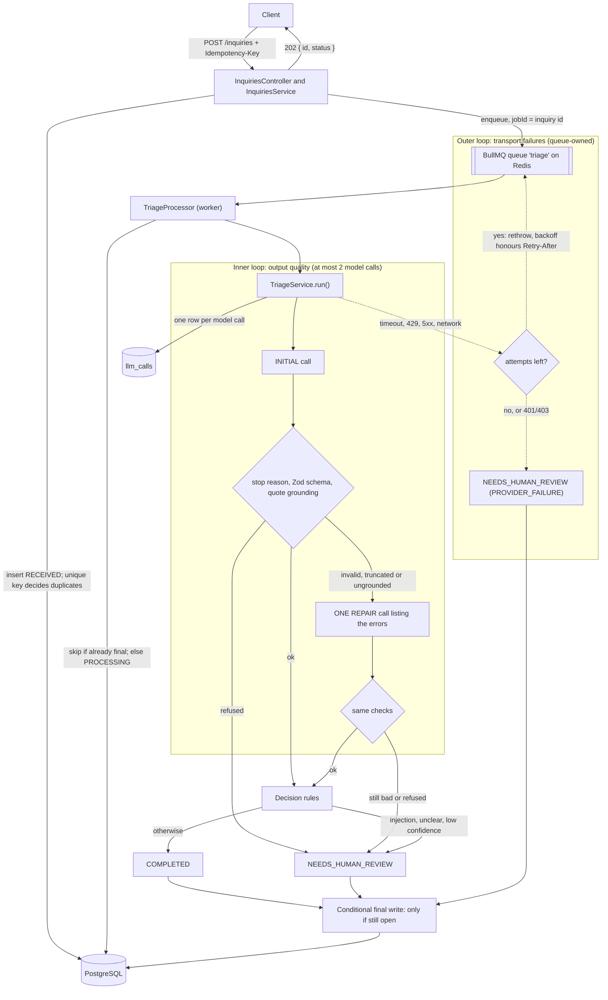

# Legal Intake Triage API

A small NestJS service that takes a free-text inquiry from a prospective law-firm client, asks an LLM to classify it (practice area, urgency, missing information), and **does not trust the answer until it passes explicit checks**. The point is not the classification. It is the reliability layer around an LLM call: timeouts, queue-owned retries, schema validation, quote grounding, one bounded repair call, a human-review fallback, idempotency at both the API and the worker, and an audit row for every model call. Every inquiry is meant to end in exactly one of two states: `COMPLETED` (trusted result) or `NEEDS_HUMAN_REVIEW` with a machine-readable reason. The two known ways an inquiry can stay open are listed under [Known limitations](#known-limitations).

> **A focused demonstration project, not a production system.** All data is synthetic: no real people, firms or cases. It was built with [Claude Code](https://claude.com/claude-code) from the specification in [`SPEC.md`](SPEC.md), milestone by milestone. The spec is kept in the repo and updated where the build deliberately departed from it.

---

## Architecture



The two loops never overlap. A **bad output** gets at most one repair call, because re-sending the identical request tends to reproduce the identical mistake. A **transport failure** is retried by the queue, because there trying again really can succeed. The OpenAI SDK's own retries are turned off, so there is exactly one retry policy.

---

## Failure modes

| Failure | How it is detected | What the system does | Proved by |
|---|---|---|---|
| Provider timeout, network error, 5xx | SDK error mapped to `LlmTransportError` (retryable) | Re-thrown; BullMQ retries with exponential backoff and jitter; last attempt → `NEEDS_HUMAN_REVIEW (PROVIDER_FAILURE)` | `test/triage-processor.int-spec.ts` tests 13, 14; real-queue retry in `test/triage-e2e.int-spec.ts` |
| 429 rate limit | HTTP 429, `Retry-After` header | Backoff uses `Retry-After` (capped at 60 s) | `src/triage/backoff.spec.ts` (test 17); processor test 13b |
| Upstream error inside a 200 response, or empty `choices` | Body inspection in the adapter | Treated like the matching HTTP status | `src/llm/openai-compatible-llm.client.spec.ts` |
| Bad API key (401/403) | HTTP status | Not retried → `PROVIDER_FAILURE` immediately | processor test 15 |
| Content moderation 403 | `error.metadata` shape (OpenRouter docs) | Mapped to a refusal → `MODEL_REFUSED` | adapter spec, "403 variants" |
| Model refuses | `message.refusal` or `finish_reason: content_filter` | `MODEL_REFUSED`, no repair call | `src/triage/triage.service.spec.ts` test 8 |
| Output cut off by the token limit | `finish_reason: length` | Treated as invalid → repair | service test 7 |
| Invalid JSON or wrong schema | Zod parse | One repair call listing the Zod issues; still invalid → `INVALID_OUTPUT` | service tests 2, 3 |
| Invented or edited evidence quote | Grounding: normalized substring check | One repair call listing the missing quotes; still ungrounded → `UNGROUNDED_EVIDENCE` | service tests 4, 5, 6; `src/triage/grounding.spec.ts` |
| Prompt injection in the inquiry | Model flags `containsInstructionsToAi`; `<inquiry>` tag look-alikes neutralized | `SUSPECTED_INJECTION` | service tests 10, 12 |
| Unclear inquiry or low confidence | `practiceArea = UNCLEAR` or `confidence < 0.7` | `LOW_CONFIDENCE`, model's suggestion kept in `result` | service test 9 |
| Same request sent twice, or concurrently | Unique index on `idempotencyKey` (insert first, then handle `P2002`) | One row; replay → `200` with current state; different body → `409` | `test/inquiries.int-spec.ts` tests 19–21 |
| Job delivered twice (BullMQ is at-least-once) | Status check before work; conditional final write | Model not called again; a late duplicate never overwrites a final state | processor test 16, "late duplicate" test |
| Bug or database error during processing | Any non-transport error | Retried through the normal attempts, then `INTERNAL_ERROR`. Exception: if the database is still down for the final write, the inquiry stays `PROCESSING` (see Known limitations) | processor "INTERNAL_ERROR" tests |
| Job failed by BullMQ itself (stalled too often) | Worker `'failed'` event with `finishedOn` set | `INTERNAL_ERROR` | e2e "stalling too often" test (reproduces BullMQ's deferred failure) |
| Job lost between insert and enqueue | Client replays the same request | Replay of a still-`RECEIVED` inquiry re-enqueues (same `jobId`, so a no-op if the job exists) | e2e "replay … lost job" test |
| Postgres or Redis unreachable during a `POST` | Prisma's connection errors (`P1001`, `ECONNREFUSED`, connect timeout); any enqueue failure, with the enqueue bounded at 1.5 s (no offline queue, so a lost connection fails at once) | `503` with `Retry-After: 5`, logged as a dependency outage (class and code only). If the row was saved it stays `RECEIVED`, and the client's replay re-enqueues it | `test/dependency-outage.int-spec.ts` (real outage: Postgres and Redis on a dead port; Redis `503` in under 2 s, then replay → `COMPLETED`) |
| Shutdown (SIGTERM) while a job is in flight | Nest shutdown hooks | New requests get `503`; the worker finishes its current job (with none in flight it closes without waiting, so shutdown also completes while Redis is down); queue, Redis and Postgres connections close | Checked by hand with `docker stop`: `503` during shutdown, the in-flight inquiry still reached `COMPLETED`; Redis-down shutdown in `test/dependency-outage.int-spec.ts` |
| Inquiry text leaking into logs, Redis or error responses | Design rule | Logs carry ids, outcomes, timings, error class and code only; jobs carry only the id; job errors are sanitized; malformed or oversized bodies get fixed messages (`400`, `413`), never the parser's text | `src/common/safe-exception.filter.spec.ts`; processor log-line test; malformed-JSON and 413 tests in `test/inquiries.int-spec.ts` |

---

## Design decisions and trade-offs

- **Async over sync.** `POST` returns `202` immediately. LLM calls take seconds and fail often; a queue gives retries without a waiting client, a rate limit on outgoing calls, and durable work in progress.
- **One repair instead of open-ended retries.** The repair call carries the specific errors back to the model, which a plain retry does not. A budget of one keeps cost and latency per inquiry bounded (at most 2 model calls per attempt).
- **Retries owned by the queue, SDK retries off.** Stacked retry layers multiply (3 SDK tries × 4 queue attempts = 12 calls), and the SDK's hidden retries would never appear in `llm_calls`. One policy, one place to observe it.
- **Quote grounding, and its limits.** Every evidence quote must appear in the inquiry after normalization (NFKC, case, curly quotes, whitespace). This catches invented or paraphrased evidence. It does **not** prove that the quote supports the conclusion.
- **Self-reported confidence is a weak signal.** The model's `confidence` decides `LOW_CONFIDENCE`, but models are often confidently wrong. It is one gate among several, not a guarantee.
- **Prompts and raw responses are not stored.** `llm_calls` records model, prompt version, tokens, latency and outcome, but never the prompt or the response. This gives up easier debugging to avoid duplicating sensitive client text.
- **Validation at the boundaries with Zod:** request bodies, environment variables, and model output all go through one library.
- **BullMQ used directly, not through `@nestjs/bullmq`:** worker concurrency, the rate limiter and the backoff strategy come from the validated environment, which the decorator-based API cannot take.

---

## Evaluation

`npm run eval` runs 20 synthetic inquiries through `TriageService` against the real provider (no queue) and writes [`eval/results.md`](eval/results.md). Raw per-case results, including every failed attempt, are in `eval/runs/`.

**Model** `nvidia/nemotron-3-super-120b-a12b:free` via OpenRouter · **prompt** `triage-v2` · structured mode `json_schema` · reasoning effort `low` · max output tokens 2000 · **timeout 20000 ms** (the default at the time; now 30000).

| Metric | Value |
|---|---|
| Practice-area accuracy (19 legal inquiries) | 95% (18/19) |
| Urgency accuracy (19 legal inquiries) | 100% (19/19) |
| isLegalInquiry accuracy | 100% (20/20) |
| Review routing matched expectation | 95% (19/20) |
| Routed to human review | 25% (5/20): LOW_CONFIDENCE 4, SUSPECTED_INJECTION 1 |
| Needed a repair call | 10% (2/20) |
| Schema or grounding failure after repair | 0 |
| Latency per case, avg / p95 | 11.5 s / 18.9 s |
| Tokens, input / output (output includes reasoning) | 16,545 / 18,299 |
| Real requests used | 25 (20 first calls + 2 repairs + 3 in two attempts retried after timeouts) |

- **c14 is the one miss.** It describes two issues (an injury, then a firing caused by it). The model answered `UNCLEAR`, so the inquiry was routed to human review (`LOW_CONFIDENCE`) rather than mislabelled. The case accepts `PERSONAL_INJURY` or `EMPLOYMENT` and is scored as a miss. Future improvement: multi-area classification (a primary area plus secondary ones).
- **Timeouts:** 2 of 22 attempts hit the 20 s timeout and were retried; successful calls took up to 18.9 s. The default is now 30 s. The evaluation was not re-run.
- **20 cases is a smoke test, not a benchmark.** One case moves any rate by 5 points.
- **The cases were written alongside the prompt's practice-area definitions and urgency rules**, by the same author, and one rule was clarified while reviewing the labels. They fit the definitions closely, so **real-world accuracy is likely lower**.

---

## Known limitations

- **Dual write.** The inquiry row is committed before the job is enqueued. If the process dies in between, the inquiry stays `RECEIVED` with no job. Partial fix: when the client replays the request (same key and body), a still-`RECEIVED` inquiry is re-enqueued. A client that never retries still leaves it stuck. The real fixes are a transactional outbox or a periodic sweeper (a stretch goal).
- **Grounding does not prove support.** A quote that exists in the text but doesn't justify the label passes.
- **Small evaluation set** (see above).
- **No authentication.** Anyone who can reach the API can call `GET /inquiries` and page through every inquiry. The list leaves out the raw text, but it includes the model's `summary` and `missingInfo`, which paraphrase it. `GET /inquiries/:id` returns the full text to anyone holding the id.
- **Prompt injection is contained, not prevented.** The model can still be influenced. What limits the damage is that its output is only stored, never executed or interpolated into queries: at worst a wrong classification, which the injection flag usually routes to review.
- **The rate limiter counts jobs, not model calls.** At 8 jobs/min and up to 2 calls per job, the worst case is 16 requests/min, under a 20/min cap; in the eval run the average was 1.25 requests per inquiry.
- **Worst case 8 model requests per inquiry:** 4 queue attempts × (1 call + 1 repair). A transport error on the repair call restarts the whole attempt.
- **The worker runs in the API process.** One process to run is fine for a demo, but a crash takes both down, and scaling the API scales the workers. In production they would be separate deployments of the same image.
- **The moderation-403 mapping is based on OpenRouter's documented error format** and has not been seen in a live response. If the real shape differs, a moderation block falls back to `PROVIDER_FAILURE`, which is safe but mislabelled.
- **`npm audit` reports 4 high-severity findings** (`mysql2`, `deepmerge-ts`), all in the Prisma CLI's dependency tree (`prisma` → `@prisma/config`). npm installs the CLI as a required peer of `@prisma/client`, so it is also present in the runtime image, although nothing executes it there. This app never connects to MySQL, and the config merge only reads this repo's own `prisma.config.ts`. The only offered fix downgrades to Prisma 6, a breaking change, so they are left until Prisma ships patched versions.
- **Still possible to end up stuck in `PROCESSING`:** if the database is down during the last attempt's final write. Stalled jobs that BullMQ fails are handled.
- **Runtime image is about 760 MB,** partly because of that Prisma CLI peer.

**If it is ever exposed publicly with a real API key**, it must sit behind a shared-secret header and a rate limiter, and the provider account must have a spend limit. The Docker setup always uses the fake provider.

---

## How to run

### With the fake provider (no API key, about 3 minutes on a first run)

Requires Docker.

```bash
git clone <this repo> && cd legal-intake-triage
docker compose up --build -d --wait     # Postgres, Redis, migrations, app (fake LLM)

curl localhost:3000/health
curl -X POST localhost:3000/inquiries \
  -H 'Content-Type: application/json' -H 'Idempotency-Key: demo-0001' \
  -d '{"text":"My landlord changed the locks yesterday and the hearing is on Friday."}'
curl localhost:3000/inquiries/<id from the response>
curl 'localhost:3000/inquiries?status=NEEDS_HUMAN_REVIEW'
```

The fake provider is a deterministic keyword classifier that always returns valid, grounded output, so the whole pipeline runs end to end. Compose pins `LLM_PROVIDER=fake` on purpose, so a local `.env` can't make it spend real requests.

### With a real provider (Node)

Requires Node `^22.22.3` or `>=24.15` (24 LTS recommended) and Docker for Postgres and Redis.

```bash
cp .env.example .env    # then set LLM_PROVIDER=openrouter, LLM_API_KEY, LLM_MODEL
docker compose up -d --wait postgres redis
npm ci
npx prisma migrate deploy
npm run llm:smoke       # exactly 1 request: prints the normalized response
npm run start:dev       # API and worker on :3000 (stop the compose `app` first if it runs)
```

For the free Nemotron model used in the evaluation, keep `LLM_REASONING_EFFORT=low` and `LLM_MAX_OUTPUT_TOKENS=2000` (reasoning tokens count against the cap). Free OpenRouter models allow 20 requests/min and 50/day. The worker's limiter and the eval's delay respect the per-minute cap.

### Tests and evaluation

```bash
npm test                 # unit tests (scripted fake LLM, no network)
npm run test:int         # integration: needs `docker compose up -d --wait postgres redis`
npm run lint && npm run typecheck && npm run format:check
npm run eval             # real provider: 20–40 requests; resumable with -- --resume
npm run eval -- --render # rewrite eval/results.md from the latest run, no requests
```

Integration tests use a separate `triage_test` database and Redis database 1, so they never touch dev data.

---

## Configuration

All variables are validated at boot; see [`.env.example`](.env.example) and SPEC §11. The ones you are most likely to touch:

| Variable | Default | Purpose |
|---|---|---|
| `LLM_PROVIDER` | `fake` | `fake` or `openrouter` |
| `LLM_TIMEOUT_MS` | `30000` | Per-request timeout |
| `TRIAGE_CONFIDENCE_THRESHOLD` | `0.7` | Below this goes to review |
| `QUEUE_ATTEMPTS` | `4` | Job attempts for transport failures |
| `WORKER_RATE_LIMIT_MAX` | `8` | Jobs started per minute |
| `MAX_INQUIRY_CHARS` | `4000` | Input size limit |

## Project layout

```
src/
  inquiries/   HTTP API: idempotent create, detail, review queue
  triage/      schema, prompt, grounding, TriageService (inner loop), queue, processor (outer loop), backoff
  llm/         LlmClient interface, OpenRouter adapter, fake clients
  common/      exception filter that logs error class and code only
  config/      Zod-validated environment
eval/          dataset, runner, results
test/          integration tests (real Postgres and Redis, fake LLM)
SPEC.md        the specification this was built from
```
